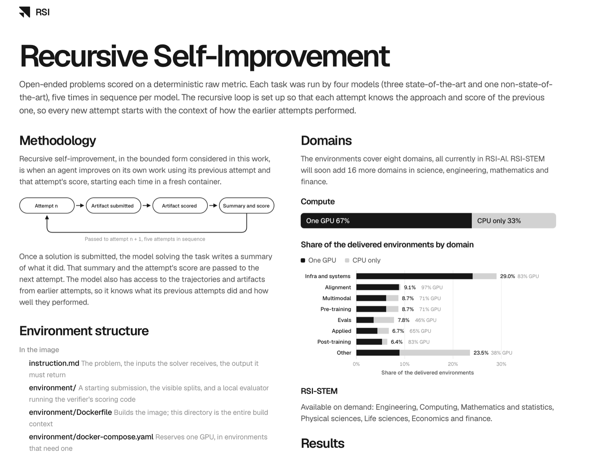

# skills

Claude Code skills. Copy a directory into `~/.claude/skills/`, then invoke it by name.

## abril-skill-htmls-scaleai

The visual system for customer-facing technical HTML: paper-and-ink palette, Aeonik
Light body with Medium headings, hairline panels instead of cards, two-column
sections, a sticky header with a sentence-case tab bar, and colour reserved for data
series. Content-agnostic, so it applies to any page whose job is to present
measurements to an outside reader.

    SKILL.md              the system: principles, shell measurements, components, copy rules
    assets/tokens.css     the whole stylesheet, paste-ready, with a class map at the top
    assets/demo.html      every component rendered, open it to see them
    assets/fonts/         Aeonik Pro, four cuts
    references/charts.md  the colour formula, mark specs, log ticks, the checks to run

## rsi-task-view

Applies that system to one kind of content: the inspection page for an RSI
optimisation task, built from a run campaign's sample HTML. One self-contained file
per task, five tabs, any model set and any iteration count.

    python3 rsi-task-view/build.py --config=task.json --fonts=path/to/fonts --check

`SKILL.md` documents the workflow, every config key, and what is read from the source
rather than supplied. `config.example.json` is a working config to copy.

## scale-one-pager

A one-page project summary (HTML plus a one-sheet PDF) for any project: big title and
description, then Methodology with a process diagram, Task structure as a file tree,
Quality assurance checks, Domains with distribution charts, and Results with headline
numbers and one plot. Sources can be a website, text, a repository or an example task
bundle; the skill asks for whatever is missing. Uses Geist from Google Fonts, so it
ships no font files.

It is written to prevent AI slop and language that should not be shared externally:
the source wording is kept and never padded, nothing is invented, and the page avoids
first person ("we", "our"), "customer", "deliverable" and internal details.

    SKILL.md              inputs to collect, content rules, build steps, checks
    assets/template.html  the page with every component and marked slots
    assets/scale-mark.svg the logo
    scripts/fit.sh        fits the page to one letter sheet, exports the PDF and a screenshot

## A note on the fonts

Both skills ship Aeonik Pro under `assets/fonts/`, which is licensed commercial
software and not redistributable. Light and Regular are woff2 from the foundry's web
package; Medium and Bold were converted locally from the desktop OTF.

**This repository must stay private.** Publishing it would distribute the font outside
the organisation, which the licence does not permit. If it is ever made public, remove
those directories first, or substitute Fontshare's Satoshi or General Sans, which are
free to redistribute and fit the same design.
