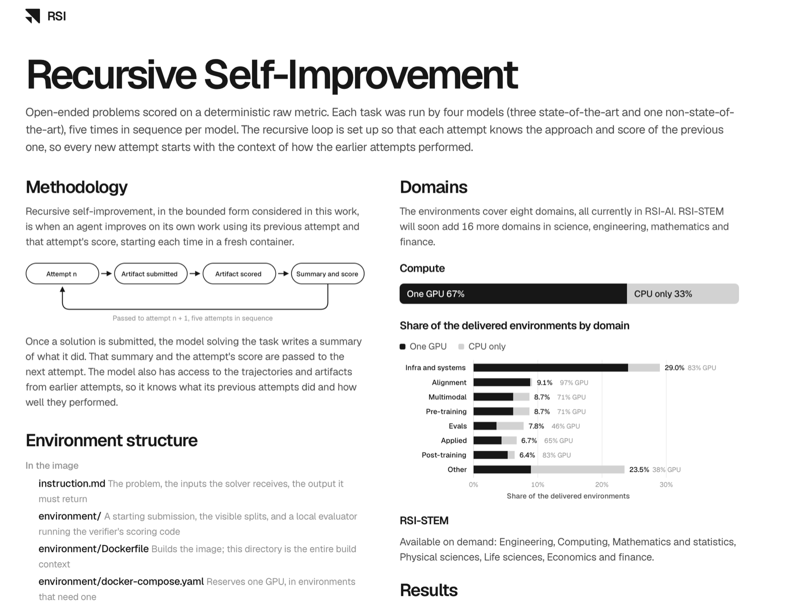

# scale-one-pager

A one-page project summary (HTML plus a one-sheet PDF) for any project. Copy this
directory into `~/.claude/skills/`, then ask for a one pager or run `/scale-one-pager`.

## What it does

The skill turns a project's own material (a website, text, a repository or an example
task bundle) into a one-page summary that is safe to share externally. It asks for
whatever is missing, then builds the page and fits it to one printed sheet.

It is written to prevent AI slop and language that should not leave the company:

- The source wording is kept. Sentences are copied as written and cut for length, not
  paraphrased or padded.
- Nothing is invented. Missing content becomes a visible placeholder.
- No filler: no intros that explain the page, no takeaways, no repeated sections.
- No first person ("we", "our") and no "customer", "deliverable" or internal details
  such as pricing, staffing or tools.
- No em dashes, analogies or marketing tone. Plain, formal sentences only.
- Numbers come from the source, never estimated.

